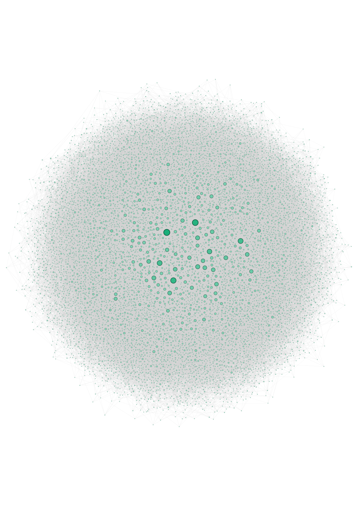

# CS490/590 Applied Graph Theory — course projects

Three graph-analysis projects from CS490/590 Applied Graph Theory (Fall 2026),
written in Python with NetworkX and Gephi.

| Project | Question | Headline result |
|---|---|---|
| [1. Exploring course prerequisite networks](project1-cpn-exploration/) | How deep are five degree programs, and which courses matter most? | Every program's highest-reach course is MATH120; ECE has the longest chain (12 courses). |
| [2. CPN analysis at scale](project2-cpn-at-scale/) | How do the full prerequisite networks of five universities compare, and what do their CS, ECE and Biology subgraphs look like? | Institutional CPNs are sparse and fragmented (largest component holds 27–55% of courses), yet chain depth is similar everywhere (12–14 courses). |
| [3. Graph generators and resilience](project3-graph-generators-resilience/) | How do RGG, Erdős–Rényi, Watts–Strogatz and Barabási–Albert graphs differ, and how do they break under random vs. targeted node removal? | BA graphs shrug off random failures but collapse under betweenness attacks; RGG fragments fastest under attack. |



## Tech stack

- Python 3.13, NetworkX (3.7 for Project 1, 3.4.2 for Projects 2–3), NumPy, SciPy, Matplotlib
- Gephi 0.11.3, driven headless from Python through JPype (optional step in Projects 2 and 3)

## Quick start

Each project is self-contained with its own `requirements.txt`:

```sh
cd project3-graph-generators-resilience
python3 -m venv .venv
.venv/bin/pip install -r requirements.txt
.venv/bin/python src/experiments.py pilot     # ~20 s
```

See each project's README for its commands, outputs and runtimes.

## Repository layout

```
project1-cpn-exploration/              five SIUE degree-program CPNs
project2-cpn-at-scale/                 five institutional CPNs + 15 program subgraphs
project3-graph-generators-resilience/  synthetic graph models and attack experiments
```

Each project has `src/` (code), `results/` (small result tables and figures) and, where
input data is needed, `data/README.md`.

## Data

Projects 1 and 2 analyze course-prerequisite data that is **not included** in this
repository:

- Project 1 uses five CSV files provided by the course instructor.
- Project 2 uses the institutional CPNs published with Yang et al. (2024) at
  <https://github.com/BonanYang/Comparative-Analysis-of-Course-Prerequisite-Networks-for-Five-Midwestern-Public-Institutions>.
  That repository has no licence, so it is linked rather than redistributed.

Each project's `data/README.md` lists the expected files and folder layout. Project 3
generates all of its graphs from recorded seeds and needs no input data.

## Author and licence

Oluwaferanmi Odedairo. Code is released under the [MIT licence](LICENSE).
