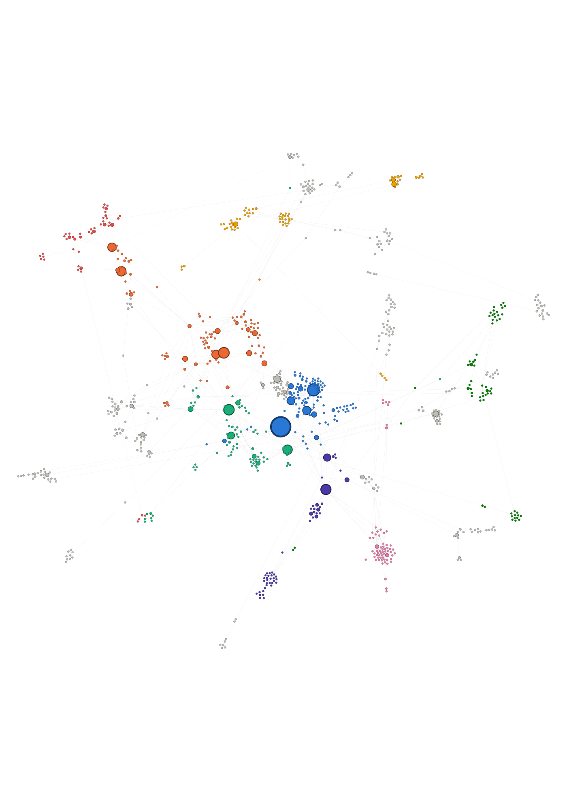

# Project 2: Course prerequisite networks at scale

Analyzes the full course prerequisite networks (CPNs) of five Midwestern public universities —
SIUE, SIUC, UIUC, Missouri S&T (MST) and UMKC — then extracts and compares their
CS, ECE and Biology program subgraphs (3 programs × 5 institutions = 15 graphs).

- **NetworkX** computes topological strata, reach, components, directed path statistics and
  the program extractions.
- **Gephi 0.11.3**, driven headless from Python, computes centrality, path, connectivity and
  modularity statistics and exports layouts.



## Setup

```sh
python3 -m venv .venv
.venv/bin/pip install -r requirements.txt
```

Place the five institutional GML files in `data/` (see [data/README.md](data/README.md)).

## Commands

Run from this folder:

| Command | What it does | Measured runtime |
|---|---|---|
| `.venv/bin/python src/partB_networkx.py` | Part B: strata, reach, components, the 15 program extractions and NetworkX charts | 17–33 s (two runs) |
| `.venv/bin/python src/gephiPipeline.py [--partA \| --partC]` | Parts A and C with the Gephi engine (needs Gephi; see below) | not measured |
| `.venv/bin/python src/compareProject1.py [--project1-dir PATH]` | Compares Project 1's SIUE graphs with the new SIUE extractions | 0.3 s |
| `.venv/bin/python src/communityPatterns.py` | Cross-institution community patterns (needs Gephi outputs) | not measured |
| `.venv/bin/python src/validate.py` | Cross-checks every output, writes `results/tables/validation_report.csv` | not measured |
| `zsh run_all.sh` | All of the above in order | not measured |

### compareProject1.py needs Project 1's output

`compareProject1.py` compares Project 1's SIUE `CS.gml`, `ECE.gml` and `BIOL.gml` with the
`results/graphs/SIUE_*.gml` extractions. Neither set is in the repository (`*.gml` is
gitignored), so after a fresh clone, create both first. From the repository root:

```sh
# 1. Project 1 graphs -> project1-cpn-exploration/results/gml/
#    (needs Project 1's CSVs in project1-cpn-exploration/data/; see its data/README.md)
cd project1-cpn-exploration
python3 -m venv .venv && .venv/bin/pip install -r requirements.txt
.venv/bin/python src/cpn_analysis.py

# 2. Project 2 extractions, then the comparison
cd ../project2-cpn-at-scale
.venv/bin/python src/partB_networkx.py
.venv/bin/python src/compareProject1.py
```

If the Project 1 GMLs are somewhere else (for example, Project 1 was run with `RESULTS_DIR`), pass
`--project1-dir PATH`. The script stops with a message naming the missing files if either
input is absent.

### Environment variables

| Variable | Default | Used by |
|---|---|---|
| `DATA_DIR` | `data/` | all scripts: folder with the five institutional GML files |
| `RESULTS_DIR` | `results/` | all scripts: output folder |
| `GEPHI_HOME` | `/Applications/Gephi.app` | `gephiPipeline.py`: Gephi 0.11.3 install (its module jars and bundled Java 17 runtime are used) |
| `CHROME_PATH` | `/Applications/Google Chrome.app/Contents/MacOS/Google Chrome` | `gephiPipeline.py`: renders Gephi's HTML statistics reports to PNG; skipped if missing |
| `PYTHON` | `.venv/bin/python` | `run_all.sh` |

## How Gephi is used

`src/gephiPipeline.py` runs Gephi without its GUI. It starts the Java 17 runtime that ships
inside Gephi.app and loads Gephi's own module jars (the modules the Gephi Toolkit is built
from) through JPype. It then calls Gephi's code directly:

- the GML importer, with edges forced **directed**;
- statistics: Degree, GraphDistance (directed), PageRank, Connected Components and Modularity;
- the ForceAtlas2 and Yifan Hu layouts, with seeds and settings recorded in
  `results/tables/gephi/*layout_settings.csv`;
- the Appearance module (node size ranked by betweenness, colour by department or community);
- the Preview PDF exporter, the Data Laboratory table exporter and the `.gephi` project writer.

Statistics panels are saved as Gephi's own HTML reports (with chart images) rather than
screenshots, and optionally rendered to PNG with headless Chrome. `validate.py` checks Gephi's
node and edge counts, weak components, giant component size, average path length, diameter,
in/out-degree and directed betweenness against independent NetworkX values. Betweenness agrees
to within 5×10⁻⁷, the rounding of Gephi's CSV export.

## Outputs

Everything is written under `results/`. The repository keeps the small, aggregate tables
and figures; per-course and per-node tables, graphs, Gephi projects and PDFs are regenerated
locally and ignored by git, because they reproduce the input data course by course.

| Path | Contents | In the repo? |
|---|---|---|
| `tables/institutions/` | Whole-CPN summary, strata, reach top-5, component and path-length distributions | Yes (except `*_course_metrics.csv`) |
| `tables/programs/` | Program summary, strata, reach top-5, prerequisite suppliers, mapping sensitivity, Project 1 check | Yes (except `course_metrics/` and the edge-level differences file) |
| `tables/gephi/` | Gephi statistics, modularity runs and stability repeats, community patterns, layout settings | Yes (except per-node exports in `institutions/` and `programs/`) |
| `figures/networkx/` | Comparison charts | Yes (except the layered per-program drawings) |
| `figures/gephi/` | Gephi Preview PDFs; one PNG render is kept | PNG only |
| `graphs/`, `gephi/`, `statistics/` | 15 program GMLs, `.gephi` projects, Gephi HTML reports | No |

## Definitions

- **Edge direction** is prerequisite → dependent course. All five CPNs are DAGs with no
  self-loops, so no edges were removed.
- **Stratum**: courses with no prerequisites are stratum 0; any other course is 1 + the maximum
  stratum of its prerequisites. **Maximum stratum** is the longest chain in edges; the longest
  chain in courses is maximum stratum + 1.
- **Reach** is the size of the forward BFS tree from a course, **including the course itself**.
- **Directed path statistics** cover only ordered pairs connected by a directed path (Gephi's
  definition).
- **Betweenness** is exact (Brandes), directed and unnormalized in both NetworkX and Gephi.
  **PageRank** uses damping 0.85.
- **Program subgraph** = every course whose label contains a target department code (including
  cross-listed labels), plus all of its transitive prerequisites, as an induced subgraph. These
  are department courses plus prerequisites, not verified degree requirements.

### Department mapping

Mappings live in `src/config.py` (`programMappings`).

| Institution | CS | ECE | BIOL |
|---|---|---|---|
| SIUE | CS | ECE | BIOL |
| SIUC | CS | ECE | BIOL |
| UIUC | CS | ECE | IB + MCB |
| MST | COMPSCI | ELECENG + COMPENG | BIOSCI |
| UMKC | COMPSCI | ECENGR | BIOLOGY |

- UIUC has no BIOL code; biology is taught as Integrative Biology (IB) and Molecular & Cellular
  Biology (MCB).
- MST's ECE department uses two codes. COMPENG is included because the other four institutions
  teach computer engineering under their single ECE code. ELECENG only gives 138 nodes instead of 178.
- SIUE/SIUC "CE" is Civil Engineering, so it is excluded.
- SIUC BIOL uses BIOL only (26 nodes). Adding ZOOL, PLB and MICR would give 149 nodes
  (`tables/programs/mapping_sensitivity.csv`).

## Key results

**Whole institutional CPNs**

| | Nodes | Edges | Weak components | Largest component | Isolated | Max stratum |
|---|---:|---:|---:|---:|---:|---:|
| SIUE | 2342 | 2135 | 951 | 883 | 854 | 13 |
| SIUC | 3979 | 3044 | 2036 | 1395 | 1905 | 13 |
| UIUC | 5126 | 3827 | 2845 | 1607 | 2644 | 12 |
| MST | 1964 | 2157 | 788 | 1083 | 756 | 12 |
| UMKC | 2304 | 1321 | 1410 | 624 | 1345 | 11 |

- **Sparse and fragmented.** Average degree is 0.57 (UMKC) to 1.10 (MST). The largest weak
  component holds only 27–55% of courses, and 36–58% of courses are isolated.
- **Depth is similar everywhere.** Maximum stratum is 11–13, so the longest chains are 12–14 courses.
- **Deep strata are mostly engineering and natural science.** Music (MUS at SIUE, CONSVTY at UMKC)
  is the notable non-STEM deep sequence.
- **Reach is concentrated in introductory math.** Every top-5 reach course at every institution is
  a MATH course; maximum reach ranges from 305 (UMKC) to 837 (UIUC MATH112). 72–83% of courses
  have reach 1: nothing depends on them.
- **Few course pairs are connected.** Only 0.05–0.29% of ordered pairs have a directed path. Among
  those, the mean shortest path is 2.33–2.74 edges and the directed diameter is 7–10.
- **Intermediate components are self-contained department sequences.** 88–98% of them come from a
  single department, e.g. SIUE's 98-course foreign-language component and UMKC's 53-course
  Conservatory component.

**Communities (Gephi modularity on the largest component)**

- Q is 0.75–0.84 at resolutions 0.5, 1.0 and 1.5 and overlaps within Gephi's run-to-run variation
  (10 repeats each), so Q alone cannot pick a resolution.
- Resolution 0.5 gives the most discipline-like communities: its lowest department purity across
  ten runs beats the highest purity at 1.0 at every institution.
- No pair of department families shares a community at all five institutions. MATH is the most
  fragmented family (spread over 5–9 communities at 0.5) because service courses are pulled into
  whichever discipline uses them. Combined with the many isolates, undirected modularity and merged
  cross-listed nodes, this is why community detection on a full CPN is messy.

**Program subgraphs**

- Sizes: CS 43–137 nodes, ECE 65–194, BIOL 26–178; UIUC is largest in all three.
  ECE is the deepest program (maximum stratum 9–11), then CS (6–10) and BIOL (5–10).
- Prerequisite-only courses come mostly from MATH; ECE also draws on PHYS (and CS at UIUC, MST
  and UMKC), and BIOL on CHEM and MATH.
- **Project 1 check (SIUE):** Project 1's CS graph (33 nodes, 49 edges) is a strict subset of the
  new extraction (43, 54). The ECE and BIOL differences are fully explained: 11 of 13 Project-1-only
  courses appear in the CPN under merged cross-listed labels, and 2 are absent from it. No edge is
  reversed.

## Limitations

- Program graphs are department courses plus prerequisites, not degree requirements, and the
  department mapping materially changes some programs (see above).
- Cross-listed courses are single merged nodes in the source data, which adds links between
  departments.
- Gephi modularity is not deterministic; each saved community assignment is one run.
- The Gephi step was run headless; the saved `.gephi` projects were checked structurally, not
  reopened in the GUI.

## Reproducibility notes

- The original runs used SciPy 1.15.3 from Anaconda. With the pinned SciPy 1.16.3, rerunning
  Part B gives tables identical to the originals, apart from float differences below 1e-9.
- Department counts in `deptComposition` columns and the supplier table are sorted by count, then
  alphabetically, so output no longer depends on Python's string-hash seed.
