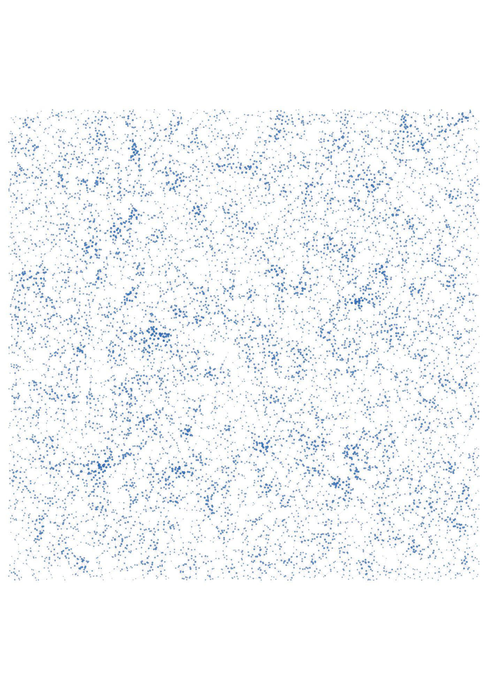
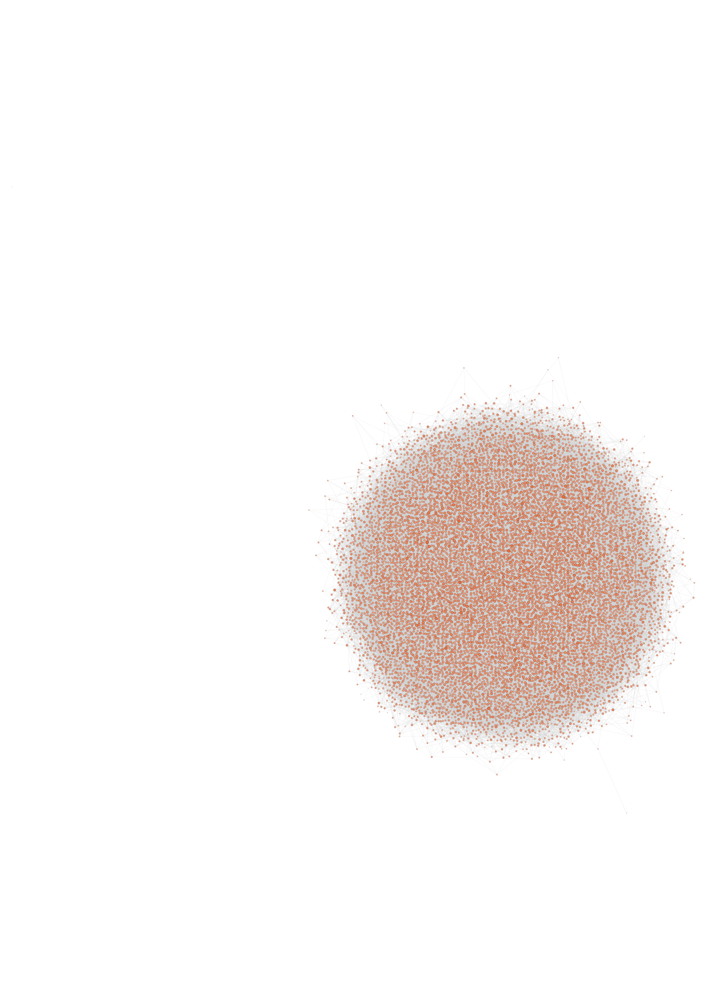
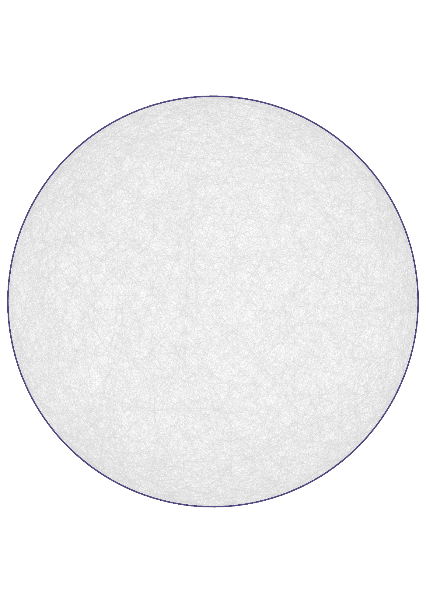
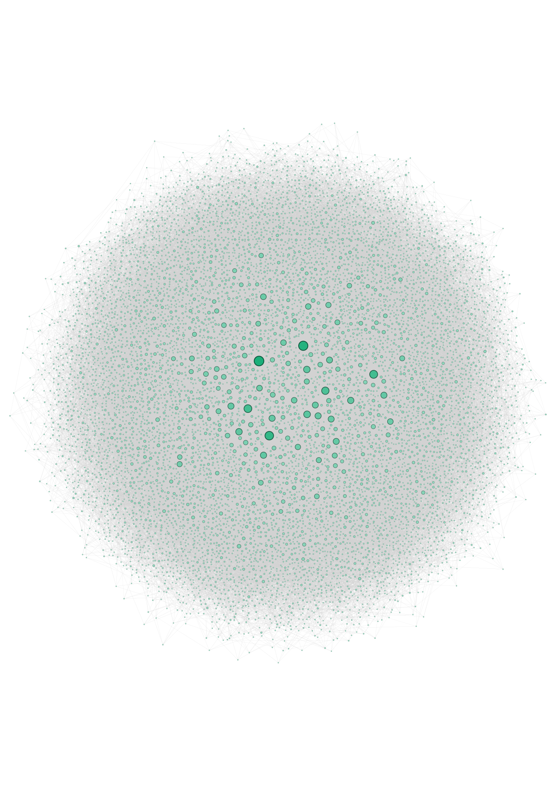

# Project 3: Graph generators and resilience

Generates synthetic networks from four models — random geometric (RGG), Erdős–Rényi (ER),
Watts–Strogatz (WS) and Barabási–Albert (BA) — at matched sizes and average degrees, compares
their structure, and measures how they fragment under random and targeted (betweenness) node
removal. Every graph is generated from a recorded seed, so all results are reproducible
without input data.

| RGG (spatial view) | ER | WS, p = 0.1 (ring view) | BA |
|---|---|---|---|
|  |  |  |  |

*n = 10,000, target degree 10, rendered with Gephi 0.11.3. Node size and shade follow degree.*

## Setup

```sh
python3 -m venv .venv
.venv/bin/pip install -r requirements.txt
```

## Commands

Run from this folder. Every command resumes from its checkpoints if rerun.

| Command | What it does | Runtime |
|---|---|---|
| `.venv/bin/python src/experiments.py pilot` | n = 10,000, d = 10: one graph per model (WS p = 0.1) | 20–22 s (measured, two runs) |
| `.venv/bin/python src/experiments.py structure` | All 36 configurations (reuses the pilot) | ~2.5 h of recorded stage time in the original run; the slowest single step, an exact diameter, took 44 min |
| `.venv/bin/python src/experiments.py resilience` | Six n = 500 graphs, 5 random trials + 1 targeted attack each | ~5 min of recorded stage time in the original run (excludes file I/O) |
| `.venv/bin/python src/plots.py` | Charts and resilience summary tables | 21 s (measured, from the committed results) |
| `.venv/bin/python src/gephiPipeline.py build [--only CONFIG_ID]` | Gephi projects and Preview PDFs for all 36 graphs | not measured |
| `.venv/bin/python src/gephiPipeline.py verify` | Reopens every `.gephi` project in a fresh Gephi JVM | not measured |
| `.venv/bin/python src/validate.py [--require-complete] [--deep] [--gephi] [--audit-targeted]` | Checks saved outputs; `--deep` regenerates graphs from seeds | not measured |

`plots.py` works straight from the committed `results/` (degree tables, attack trajectories and
metadata are included), so all charts can be rebuilt without rerunning the experiments.
`validate.py` and `gephiPipeline.py` need the full local outputs (graphs and checkpoints), which
are not committed.

### Environment variables

| Variable | Default | Used by |
|---|---|---|
| `RESULTS_DIR` | `results/` | all scripts: output folder |
| `GEPHI_HOME` | `/Applications/Gephi.app` | `gephiPipeline.py`: Gephi 0.11.3 install (its module jars and bundled Java 17 runtime are used) |

Resuming a run requires the recorded NetworkX version (3.4.2). Pilot and full structure runs
share a lock file; do not run two writers for the same experiment.

## Outputs

| Path under `results/` | Contents | In the repo? |
|---|---|---|
| `structure/structural_comparison.csv` | One row per configuration: seeds, connectivity, components, LCC share, degree stats, clustering, exact diameter, estimated path length, timings | Yes |
| `structure/degrees/` | Degree frequencies per graph (used by `plots.py`) | Yes |
| `resilience/attacks/`, `resilience/metadata/` | One trajectory CSV (501 rows) and one metadata file per attack run | Yes |
| `resilience/random_trial_summary.csv` | Mean, SD, min and max across the five random trials | Yes |
| `resilience/resilience_milestones.csv` | LCC share and components at 1/5/10/20/30/50% removed | Yes |
| `resilience/lcc_half_breakdown.csv` | First fraction removed where the LCC drops below half | Yes |
| `plots/*.png` | Analysis charts (PDF versions are regenerated locally) | PNG only |
| `figures/gephi/*.png` | The four Gephi renders above | Yes |
| `experiment_manifest.json` | Every configuration and seed | Yes |
| `structure/graphs/`, `structure/checkpoints/`, `resilience/graphs/`, `gephi/` | GML graphs (up to 30 MB each), metric checkpoints, Gephi projects and PDFs | No (regenerable from seeds) |

## Method

- **Grid:** n ∈ {10,000, 20,000, 50,000} × target degree d ∈ {10, 20}; RGG, ER, WS (p = 0.1, 0.2, 0.3)
  and BA for each pair, 36 graphs in total.
- **Generators:** RGG radius `sqrt(d / (pi n))` in the unit square; ER `gnp_random_graph` with
  p = d / (n − 1); WS with k = d; BA with m = d / 2. Actual mean degree is measured as 2E/N.
- **Seeds** are the first 32 bits of SHA-256 of a descriptive label, stable across machines and
  processes (`common.stableSeed`).
- **Measures:** connectivity and component counts (isolates included); average clustering;
  exact diameter (`nx.diameter(..., usebounds=True)`) for connected graphs only, otherwise N/A;
  estimated mean shortest path in the largest component from 64 seeded BFS sources.
- **Resilience:** n = 500 (permitted by the assignment because exact betweenness is expensive),
  RGG/ER/BA, d = 10 and 20. Random removal: five seeded trials. Targeted removal recomputes
  exact betweenness after **every** removal and removes the top node; ties go to the smallest node ID.
- **Gephi:** `gephiPipeline.py` drives Gephi's own classes headless through JPype (GML import,
  Degree statistic, ForceAtlas2, Appearance, Preview PDF export, project writer), using the same
  technique as Project 2. It checks that Gephi's node and edge sets match each GML exactly.

## Key results

Largest graphs (n = 50,000):

| Graph | Connected | Max degree | Clustering | Exact diameter | Est. mean path |
|---|---|---:|---:|---:|---:|
| RGG, d = 10 | No (7 components) | 29 | 0.588 | N/A | 87.4 |
| RGG, d = 20 | Yes | 40 | 0.591 | 145 | 53.3 |
| ER, d = 10 | No (5 components) | 24 | 0.0001 | N/A | 4.92 |
| ER, d = 20 | Yes | 41 | 0.0003 | 6 | 3.88 |
| WS, d = 10, p = 0.1 | Yes | 16 | 0.490 | 11 | 7.30 |
| WS, d = 20, p = 0.1 | Yes | 28 | 0.519 | 7 | 5.16 |
| BA, d = 10 | Yes | 646 | 0.002 | 6 | 4.14 |
| BA, d = 20 | Yes | 1251 | 0.003 | 5 | 3.47 |

- **Small world: WS only.** WS combines high clustering (0.23–0.52) with short paths. ER and BA have
  short paths but almost no clustering; RGG has high clustering but very long paths.
- **Heavy tail: BA only.** Across all 36 graphs, BA's maximum degree is 28–65 times its mean
  degree; for RGG, ER and WS it is at most 2.9 times. A straight log-log segment is suggestive, not proof of a power law.
- **Random failures:** ER and BA degrade almost linearly. Under random removal their LCC (as a share
  of the remaining nodes) stays above half until about 86–92% of nodes are gone; RGG d = 10 gets
  there at about 55%.
- **Targeted attacks:** recomputed-betweenness removal halves RGG's LCC after only 4% (d = 10) or 11%
  (d = 20) of nodes. BA reaches that point at 30% (d = 10) and is shattered into 179 components by 50%
  removal, versus 13 components for ER at the same point.
- Exact diameter is costly even with bounds: one WS graph (n = 50,000, d = 20, p = 0.2) took
  2,657 s for that calculation alone.

Sources: `results/structure/structural_comparison.csv`, `results/resilience/*.csv`.

## Reproducibility notes

- The original runs used SciPy 1.15.3 from Anaconda, whose pip wheel did not load on the macOS
  version used, so 1.16.3 is pinned. SciPy is only used for the RGG neighbour search;
  `validate.py --deep` confirmed that all graphs regenerate identically with it.
- Rerunning the pilot from this repository produced GML files byte-identical to the originals.
